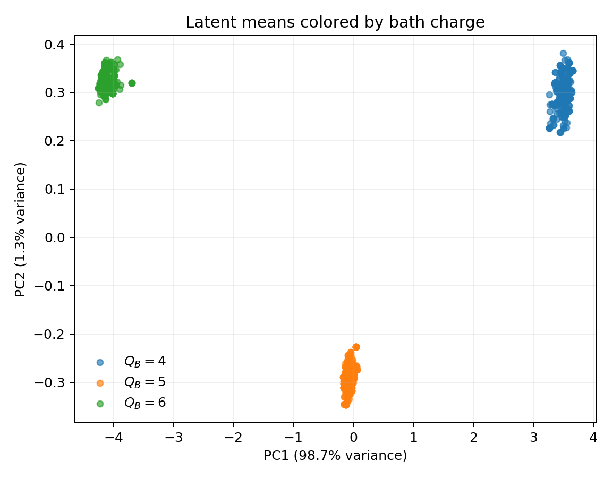

# Learning Thermodynamic Information from Quantum Measurements

*A variational information bottleneck for deep thermalization.*

**Can a neural network learn which information in a quantum measurement record actually matters?** This project uses a variational autoencoder (VAE) to compress measurements of a quantum environment and predict measurement outcomes on a small subsystem.

## 🌌 Motivation: from deep thermalization to coarse-graining

Our earlier [PRX Quantum paper](https://doi.org/10.1103/PRXQuantum.6.020343) studied **deep thermalization**: the emergence of universal statistics of quantum states conditioned on measurements of their environment. A key idea is **coarse-graining**. Although there are exponentially many microscopic bath measurement outcomes, the limiting *projected ensemble* can be described using far less information about conserved charges and the measurement basis. The paper develops this universal description and rigorously establishes its fixed-charge, charge-revealing measurement limit.

This motivates a machine-learning question: **Can a model discover the relevant coarse-grained information directly from measurement data?** Our first test focuses on conserved charge. We train a model to predict subsystem measurements **without providing charge labels**, then check what physical information emerges in its compressed representation.

## 🔬 Physical setup

We study **12 qubits**, divided into a small subsystem **A (2 qubits)** and an environment, or **bath B (10 qubits)**. A random pure state in the fixed total U(1) charge sector $Q=6$ models late-time scrambling from a Néel-state preparation; we do **not** simulate time evolution explicitly.

Measuring B in the computational (Z) basis produces a 10-bit record $z_B$ and a conditional state on A. Conservation of charge means $Q_A + Q_B=6$, with possible bath charges $Q_B=4,5,6$. We ask whether a compact representation of $z_B$ retains enough information to predict measurements of A in different Pauli bases.


## 🧠 Model

A Transformer encoder compresses each bath measurement record into a Gaussian latent distribution:

$$
q_\phi(h \mid z_B)
=
\mathcal{N}\left(
\mu_\phi(z_B),
\mathrm{diag}\left(\sigma_\phi^2(z_B)\right)
\right).
$$

Here, the encoder learns the latent mean and variance, while a conditional decoder uses the latent representation and the chosen Pauli measurement bases to predict subsystem outcomes:

$$
z_B \xrightarrow{\text{encoder}} h,
\qquad
(h,U_A) \xrightarrow{\text{decoder}}
p_\theta(z_A \mid U_A,h).
$$

For our two-qubit subsystem, the decoder outputs probabilities for four possible measurement outcomes: 00, 01, 10, and 11.

**Importantly, the model is trained without charge labels.** The bath charge is used only after training to evaluate whether the latent representation has learned physically meaningful information.


## ⚙️ Data generation and computation

[`data_generation_Neel.ipynb`](data_generation_Neel.ipynb) constructs a normalized random state in the fixed-charge sector and samples its bath and subsystem measurements. It generates the included [`U1_dataset_LA=2_LB=10_Neel.csv`](U1_dataset_LA=2_LB=10_Neel.csv) with:

- **1,000** bath draws (`M_B=1000`) and **4** random local Pauli measurements of A per draw (`R_A=4`): **4,000 rows**.
- A fixed random-state seed of **48** and measurement-sampling seed of **49**.
- Columns `outer_id`, `z1`–`z10`, `P1`, `b1`, `P2`, `b2`. The Pauli codes are **2=X, 3=Y, 4=Z**.

The training code groups the four A-side measurements belonging to the same `outer_id`, sharing one latent sample per group. By default, train/validation/test sets are separated by **exact bath bit string** (and hence also by `outer_id`), so an identical $z_B$ cannot leak across splits.

## 📉 Loss function

For bath draw $j$ with $R_A$ subsystem measurements, the objective is

```math
\mathcal{L}_j =
\mathbb{E}_{h \sim q_\phi(h\mid z_{B,j})}
\left[
-\frac{1}{R_A}
\sum_{r=1}^{R_A}
\log p_\theta(z_{A,jr}\mid U_{A,jr},h)
\right]
+
\beta D_{\mathrm{KL}}
\left(
q_\phi(h\mid z_{B,j})
\| \mathcal{N}(0,I)
\right).
```

The reconstruction term rewards **conditional measurement predictions**; the KL term limits information retained about the bath record. The KL penalty is counted **once per bath draw**, not once per A-side shadow.

## 📊 Preliminary result



In the supplied CPU baseline, latent means form three clusters associated with bath charge $Q_B=4,5,6$. The first two principal components explain **98.7%** and **1.3%** of the latent variance. This supports the interpretation that the representation retains charge information, but **does not by itself demonstrate reconstruction of the full projected ensemble**. Quantitative checks include held-out predictive likelihood and post-training charge and microscopic-information probes.

## 🚀 Quick start

From the repository root, install Python dependencies and a compatible [PyTorch](https://pytorch.org/get-started/locally/) build:

```bash
python -m pip install torch
python -m pip install -r requirements.txt
```

Train using the **included CSV**:

```bash
python -m charge_extraction.train \
  --csv U1_dataset_LA=2_LB=10_Neel.csv \
  --output-dir runs/baseline \
  --device auto \
  --beta 1e-3 \
  --latent-dim 2
```

Results are saved under `runs/baseline/`, including predictive metrics, latent diagnostics, a PCA plot, and model checkpoints. These are example training settings; the bundled plot is from a supplied CPU baseline, so a new run is not guaranteed to give the identical figure.

To **regenerate the CSV**, install JupyterLab and open the notebook from the repository root, then run its cells in order:

```bash
python -m pip install jupyterlab
jupyter lab data_generation_Neel.ipynb
```

The notebook writes `U1_dataset_LA=2_LB=10_Neel.csv` in its working directory. With the included seeds, it reproduces the bundled dataset exactly in the verified environment. To run a parameter sweep, see `python -m charge_extraction.sweep --help`.

## 🧪 Tests and scope

```bash
python -m unittest discover -s charge_extraction/tests -v
```

This repository is an initial **charge-extraction proof of concept**, not a test of the full deep-thermalization theory. In particular, distinct bath strings with the same charge can still yield distinct conditional pure states; the charge-based simplification concerns the **universal ensemble statistics**. Learning varying thermodynamic parameters and reconstructing higher projected-ensemble moments are future directions.

## 📚 Reference

R.-A. Chang, H. Shrotriya, W. W. Ho, and M. Ippoliti, **[Deep Thermalization under Charge-Conserving Quantum Dynamics](https://doi.org/10.1103/PRXQuantum.6.020343)**, *PRX Quantum* **6**, 020343 (2025).

*Related ML inspiration: [EmergentClassicality](https://github.com/EverettYou/EmergentClassicality), adapted here to bath-conditioned subsystem measurements.*
